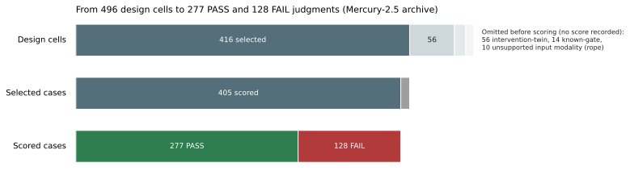
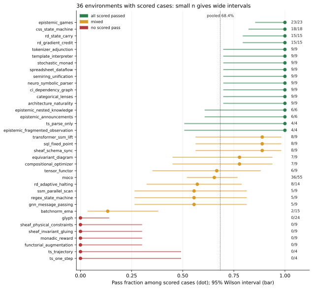
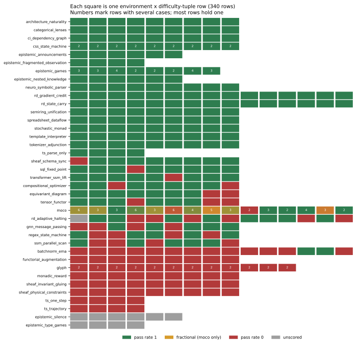
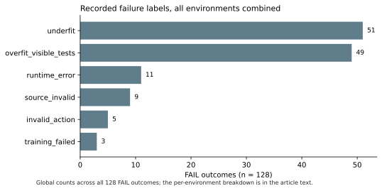

*by StrangeTcy*

<dl class="epistemic-status">
  <dt>Original ideas</dt><dd>A retrospective look at the archived Mercury-2.5 results, comparing environments and examining how their outcomes are distributed, with no new model runs.</dd>
  <dt>Synthesis</dt><dd>I grouped the 416 selected cases in 38 environments and a 340-row environment × difficulty-tuple matrix to set the pooled pass rate against case counts, endpoints, case density, and the confounds the archive records.</dd>
  <dt>Prose</dt><dd>Written for this article in the first person, with every figure tied to the reported counts.</dd>
  <dt>Certainty</dt><dd>I am fairly confident in the counts, but much less confident about any cause or mechanism, because the archive has a single seed, a dirty source state, unscored cases, two kinds of judge guarantee, and some open discrepancies.</dd>
  <dt>Importance</dt><dd>One pooled benchmark number can hide where its cases sit, how unevenly they are spread, and how little the archive can actually support.</dd>
</dl>

*Revision note: This version replaces the one first published under this title. The headline figure, 68.4%, has not changed. I have corrected several passages, added an environment × difficulty-tuple matrix as an exploratory second layer, and listed the withdrawn and open claims in their own section instead of quietly removing them.*

Mercury-2.5 received PASS judgments on 68.4% of the scored cases in this campaign. What would I expect if I opened one of its environments at random? The `ts_*` results make that question awkward. `ts_parse_only` is 4/4, while `ts_one_step` and `ts_trajectory` are each 0/4. All three count toward the same pooled number. A single pooled pass rate can turn very uneven environment-level results into one tidy figure.

My aim is to understand what that number summarizes, not to replace it with a different slogan. These are outcomes that the campaign's judges assigned to selected cases. They are not repeated measurements of general capability, and an environment name is not a difficulty rating. This is a retrospective analysis of archived results. It was not preregistered. Still, the differences between environments are too large to leave unstated. The 68.4% figure is arithmetically correct, but on its own it describes little. The more useful structure is the endpoint-heavy map underneath it.

## First, count the cases that received a judgment

The archive contains **416 selected cases in 38 environments**. Of these, 405 received a PASS or FAIL judgment: 277 PASS and 128 FAIL. So **277/405, or 68.4%**, is the scored-case pass rate (the case-weighted pooled rate). The other 11 cases have no scored result. The archive labels them `infrastructure_unscored` and records no further cause, so I do not describe them as judge gaps or as a third kind of outcome.

*Figure: From the 496 design cells, 80 were omitted before scoring and 416 were selected. Of the 416, 11 have no scored result (the archive's `infrastructure_unscored` status) and 405 were scored: 277 PASS and 128 FAIL. The omitted cases have no score, so they are outside every pass rate in this article. Nine of the 128 scored FAILs carry a disposition label that conflicts with their scored status; the text explains this.*

The fraction **277/416, or 66.6%**, answers a different question: what share of *all selected cases* has an observed PASS? It must not be presented as a pass rate, because doing so silently turns the 11 unknown outcomes into failures.

| Environment outcome | Environments | PASS / scored cases | Share of scored cases | Unscored cases |
|---|---:|---:|---:|---:|
| Every scored case passed | 17 | 172/172 | 42.5% | 0 |
| No scored case passed | 7 | 0/68 | 16.8% | 0 |
| Some passed, some failed | 12 | 105/165 | 40.7% | 1 |
| No scored cases | 2 | — | — | 10 |
| **Total** | **38** | **277/405** | **100%** | **11** |

Of the 36 environments with scored cases, 24 sit at an observed endpoint: every scored case passed or every scored case failed. I call the map *endpoint-heavy*. I am not claiming a capability split into two populations. Some endpoints rest on four cases and others on 23 or 24, and because every case ran under one seed, the table cannot say how stable any endpoint would be.

The mixed environments are not minor exceptions. They hold **165 of the 405 scored cases (40.7%)**, with 105 PASS among those 165 and one additional unscored case. Their results range from 2/15 to 8/9.

Across the 36 scored environments, the unweighted mean of the pass fractions is about 69.2%, and the median is 8/9 (88.9%). Each of these summaries answers a different question, and each still hides the shape of the map.

## The endpoint-heavy distribution

Out of the 36 scored environments, 24 sit at an endpoint.

*Figure: Each dot is one environment's pass fraction among its scored cases; each bar is a 95% Wilson interval; the dotted vertical line is the pooled 277/405 = 68.4%, and the label beside each bar is PASS/scored. Environments with 4 to 9 cases have wide intervals. The intervals treat each environment's scored cases as a sample under one seed. They do not estimate a population of environments, and they are not a measure of seed-to-seed variation. Environments with no scored cases are not drawn.*

- **17 all-pass environments (rate 1.0), 172/172 scored cases.** That is 17 of 36 scored environments (47%).
  - **9/9:** `architecture_naturality`, `categorical_lenses`, `ci_dependency_graph`, `neuro_symbolic_parser`, `semiring_unification`, `spreadsheet_dataflow`, `stochastic_monad`, `template_interpreter`, and `tokenizer_adjunction`.
  - **Larger environments:** `css_state_machine` 18/18, `rd_gradient_credit` 15/15, `rd_state_carry` 15/15, and `epistemic_games` 23/23.
  - **Smaller environments:** `epistemic_announcements` 6/6, `epistemic_nested_knowledge` 6/6, `epistemic_fragmented_observation` 4/4, and `ts_parse_only` 4/4.
  - **Caveat for `ts_parse_only`:** One of its four PASS cases is marked performance-ineligible. Its exclusion note describes a provider-attributed terminal failure, yet its verdict is PASS. I keep it in the 277, but those two records disagree.
- **7 all-fail environments (rate 0.0), 0/68 scored cases.** These are `functorial_augmentation` 0/9, `monadic_reward` 0/9, `sheaf_invariant_gluing` 0/9, `sheaf_physical_constraints` 0/9, `ts_one_step` 0/4, `ts_trajectory` 0/4, and `glyph` 0/24.
  - **Caveat for `monadic_reward`:** 8 of its 9 scored FAIL cases also carry the case disposition `rejected`. The archive does not define that term. I keep all of them in the counts, so this 0/9 may not mean the same thing as the other zeros.

That leaves the 12 mixed environments:

| Environment | PASS / scored |
|---|---:|
| `sheaf_schema_sync` | 8/9 |
| `sql_fixed_point` | 8/9 |
| `transformer_ssm_lift` | 8/9 |
| `compositional_optimizer` | 7/9 |
| `equivariant_diagram` | 7/9 |
| `tensor_functor` | 6/9 |
| `gnn_message_passing` | 5/9 |
| `regex_state_machine` | 5/9 |
| `ssm_parallel_scan` | 5/9 |
| `moco` | 36/55 |
| `rd_adaptive_halting` | 8/14 (+1 unscored) |
| `batchnorm_ema` | 2/15 |

The 68.4% pooled rate therefore sits above a landscape in which most scored environments landed at an endpoint rather than anywhere near 68%.

## Names are useful handles, not forecasts

It is tempting to treat prefixes such as `ts_*` or `sheaf_*` as coherent families and to expect shared outcomes within each one. In this archive, those labels are an unreliable shortcut.

The `ts_*` trio is the clearest small example. `ts_parse_only` is 4/4 (with the ineligibility flag noted above), while `ts_one_step` and `ts_trajectory` are each 0/4. That accurately describes three sets of four judged cases. It is not evidence of a difficulty ladder. There is no shared difficulty scale here, and these are not repeated trials of the same test.

The `sheaf_*` names set the opposite trap. `sheaf_schema_sync` is 8/9, while `sheaf_invariant_gluing` and `sheaf_physical_constraints` are each 0/9. Combining all three into one "sheaf performance" figure would hide the very contrast that stands out. Category-theory-flavoured names are no more predictive: `categorical_lenses` is 9/9, `functorial_augmentation` is 0/9, and `tensor_functor` is 6/9. A shared name does not imply shared outcomes in this archive.

`glyph`, `moco`, and `batchnorm_ema` reinforce the same caution:

- `glyph` is 0/24, a much larger all-fail block than the four-case `ts_*` zeros.
- `moco` is 36/55 (65.5%), with 19 failures.
- `batchnorm_ema` is 2/15 (13.3%), with 13 failures. One of those failures carries the undefined `rejected` disposition.

Together, these three environments contribute **94 of the 405 scored cases but 56 of the 128 failures**. That shows concretely how much the pooled result depends on where cases were selected. It does not show that the three environments share a failure mechanism.

## A second layer: the environment × tuple matrix

Within each environment, cases are organized by difficulty tuples. The archive includes a matrix with one row per environment × tuple: **340 rows** in total. Each environment has between 4 and 15 rows, and six environments have more than 10.

*Figure: Each square is one environment × difficulty-tuple row, coloured by its pass rate; grey marks rows with no scored case, and a number marks rows holding more than one case. Most rows hold a single case, so most squares are 0 or 1. The fractional values appear only in moco. The tuples carry environment-specific labels, so columns are not comparable across environments.*

There are **34 difficulty dimension names** across the matrix. The tuples are specific to each environment. A dimension in one environment is not calibrated against a dimension in another. For that reason, I do not pool, rank, or regress tuples across environments, and I do not read any tuple-level pattern as a difficulty effect.

The matrix contains four main facts:

- **Most rows hold a single case.** 296 of 340 rows contain one case. The 44 multi-case rows are all in four environments: `moco` (15 rows, 55 cases), `glyph` (12 rows, 24 cases), `css_state_machine` (9 rows, 18 cases), and `epistemic_games` (8 rows, 23 cases).
- **Most row outcomes are binary.** 329 rows have a pass rate, and 320 of those (97.3%) are exactly 0 or 1. The nine fractional rows are all in `moco`. Since most rows hold one case, a rate of 0 or 1 is mostly unavoidable. It is not evidence of sharp tuple boundaries.
- **Many rows sit in uniform environments.** 204 of 340 rows (60%) belong to environments where every scored row has the same outcome. Adding the 10 rows of the two environments with no scored case gives 214 (63%), but those rows have no outcome, so I do not count them as uniform behaviour.
- **Zero-pass tuples are widespread.** 98 individual tuples have no passes, and they occur in 19 environments. That is far more than the seven environments with no passes at all. All 12 mixed environments contain at least one zero-pass tuple.

This layer is exploratory. It shows how the cases are arranged, but it does not explain why any tuple passed or failed.

## What a "cell" means

The campaign describes its design as "one seed per cell," and that wording is ambiguous. The `seed` column of the per-case records is 0 for all 416 selected cases, and no second-seed rerun is recorded. If a cell meant a single case, the phrase would add nothing. The row counts suggest the intended meaning: 340 rows hold 416 cases, and 44 rows hold more than one case, all at seed 0. So a cell most plausibly means an environment × tuple row. That is my inference from the arithmetic. The archive does not state it as a convention.

Either way, the 405 scored cases are not 405 distinct tuples, and they are certainly not 405 independent tests of a general ability. `moco` alone supplies 55 scored cases (13.6% of all scored cases) from 15 tuples. The aggregates cannot estimate how correlated cases within a tuple are. In `moco`, the only environment whose multi-case rows disagree, there is no row-by-row key. In `glyph`, `css_state_machine` and `epistemic_games`, every multi-case row is unanimous, which is consistent with strong within-row agreement but does not establish it.

Because case density is uneven, a few environments pull hard on the global average:

| Scenario | Pass rate | Change |
|---|---:|---:|
| Exclude `moco` | 241/350 = 68.86% | +0.46 pt |
| Exclude `glyph` | 277/381 = 72.70% | +4.31 pt |
| Exclude both | 241/326 = 73.93% | — |
| Shrink `moco` to 9 cases at its own 65.5% rate | about 68.8% | about +0.4 pt |

These are arithmetic sensitivities, not alternative results. Weighting environments equally does not settle the question either. The unweighted mean (about 69.2%) lands close to the case-weighted rate, while the median (88.9%) hides the seven all-fail environments.

## `moco`: the only fractional rows

`moco` is the only environment whose rows are not all 0 or 1. Of its 15 rows, 6 sit at 0.0 or 1.0, and the other 9 are fractional. The fractional values that appear are 1/6, 1/3, 2/5, 2/3, 3/4, and 5/6.

The archive has no row-by-row key linking each value to its tuple. I therefore cannot draw the shape of `moco` across its difficulty dimensions. I can say that its 36/55 is spread across both endpoint rows and fractional rows. I cannot say how that spread lines up with any dimension.

## Claims withdrawn or left open

**Withdrawn:** An earlier claim of non-monotonic difficulty in `css_state_machine`. That environment is 18/18, so every one of its nine tuple rows is 2/2. There is no variation in it to describe.

**Open, not findings:** Possible non-monotonic patterns in `moco` and in a SQL environment. With a single seed and mostly binary rows, patterns like these can arise by chance. I have not computed how often they would appear by chance, so I treat them as questions, not results.

## Unscored cases are not failures

The 11 cases with no scored result are:

- 6 in `epistemic_silence`
- 4 in `epistemic_type_games`
- 1 in `rd_adaptive_halting`

The first two environments have no scored case at all, which is why the scored-environment count drops from 38 to 36. The unscored `rd_adaptive_halting` case sits at the tuple where all five dimensions are `easy`. The archive records no cause for the gap, and that tuple label does not make the case evidence about difficulty.

Recoding these 11 cases as failures would put invented outcomes into the denominator. The scored pass rate stays at 277/405. The all-selected figure, 277/416, answers a different question. `rd_adaptive_halting` remains 8/14 scored plus one unscored case. It is not a 15-case judgment with an assumed failure.

## Ten zero-pass environments or seven?

An earlier project summary says there are 10 zero-pass environments. The environment-level count gives 7. I tested one possible explanation: counting environments with at least one zero-pass tuple. That gives 19, so it does not reproduce 10 either. I do not know where the 10 comes from. Two readings are untested. Seven all-fail environments plus the two with no scored case give 9. Adding `rope`, which has no row in the 38-environment tables and whose 10 cases were all omitted before scoring, gives 10 only if `rope` is counted as zero-pass. Its cases were never scored, so that count would not mean the same thing as the others. I use 7 in this article, and the reconciliation remains open.

## What can a FAIL label explain?

The archive assigns these labels to the 128 FAIL outcomes:

*Figure: Recorded failure labels for all 128 FAIL outcomes combined. These are global counts. The per-environment breakdown is in the table below, built from the same per-case records.*

| Label | Count |
|---|---:|
| `underfit` | 51 |
| `overfit_visible_tests` | 49 |
| `runtime_error` | 11 |
| `source_invalid` | 9 |
| `invalid_action` | 5 |
| `training_failed` | 3 |
| **Total** | **128** |

The `runtime_error` count combines 9 cases recorded as `RUNTIME_ERROR` and 2 recorded as `runtime_error`. The archive normalises both spellings to one label, and I treat the casing difference as a data-quality artefact rather than two kinds of runtime failure.

These are recorded classifications, not observations of Mercury-2.5's internal reasoning. I cannot infer a mechanism from the label names.

The per-case records do carry the environment for each FAIL, so the labels can be broken down by environment. The breakdown is below. It is descriptive only, and it rests on the recorded labels.

| Environment | FAIL | Recorded labels |
|---|---:|---|
| `glyph` | 24 | overfit_visible_tests 22, underfit 1, invalid_action 1 |
| `moco` | 19 | overfit_visible_tests 16, training_failed 2, invalid_action 1 |
| `batchnorm_ema` | 13 | overfit_visible_tests 11, training_failed 1, invalid_action 1 |
| `functorial_augmentation` | 9 | underfit 6, runtime_error 3 |
| `monadic_reward` | 9 | source_invalid 8, invalid_action 1 |
| `sheaf_invariant_gluing` | 9 | underfit 9 |
| `sheaf_physical_constraints` | 9 | underfit 9 |
| `rd_adaptive_halting` | 6 | runtime_error 5, underfit 1 |
| `gnn_message_passing`, `regex_state_machine`, `ssm_parallel_scan`, `ts_one_step`, `ts_trajectory` | 4 each | underfit 17, invalid_action 1, runtime_error 2 |
| `tensor_functor`, `compositional_optimizer`, `equivariant_diagram`, `sheaf_schema_sync`, `sql_fixed_point`, `transformer_ssm_lift` | 3, 2, 2, 1, 1, 1 | underfit 8, runtime_error 1, source_invalid 1 |

The rows above sum to 128. Two patterns stand out. Most `glyph` and `moco` failures carry the overfit label, and the three `sheaf_*` environments with FAIL cases (`sheaf_invariant_gluing` 9, `sheaf_physical_constraints` 9, `sheaf_schema_sync` 1) carry only underfit labels. Both are descriptions of recorded labels. Neither shows why the cases failed.

Nine of the ten `rejected` cases carry the `source_invalid` label (eight in `monadic_reward`, one in `transformer_ssm_lift`). The tenth, in `batchnorm_ema`, carries a different label. The disposition and the label therefore overlap, but they are not the same field.

Judge guarantees add a second limit. Across the 416 selected cases, the campaign records **189 `behavioral_reference` and 227 `compile_only`** guarantees, and those totals include unscored cases. Each environment carries exactly one guarantee: 11 environments are `behavioral_reference` and 27 are `compile_only`. The guarantee is therefore fixed by environment, and I cannot separate a guarantee effect from an environment effect.

By guarantee, the scored results are: `behavioral_reference`, **141/189 (74.6%)** across 11 environments; `compile_only`, **136/216 (63.0%)** across 27 environments, with 11 further unscored cases. These two numbers differ, but the difference is confounded with which environments fall in each group. I do not read it as a judge effect. A PASS under one guarantee does not establish what a PASS under the other does. A PASS records only what that case's judge checked. It does not show that the model understood or solved the task.

## The selection frame

The 416 cases are themselves a selection. Before scoring, **80 cases** were omitted:

| Omission reason | Cases |
|---|---:|
| Intervention-twin omissions | 56 |
| Known-gate calibration failures | 14 |
| Unsupported input modality (all in the `rope` environment) | 10 |

`rope` appears in none of the 38-environment tables. All 10 of its cases were omitted before scoring. The provenance summary instead gives **24** known-gate omissions, which disagrees with the exclusion record's 14. The 14 is the figure that fits the 496-cell frame (56 + 14 + 10 = 80, and 416 + 80 = 496). With 24, the omissions would total 90 and the frame would need 506 design cells. So the 24 cannot coexist with the selection frame as reported, and I leave the conflict open rather than resolve it silently. I report both and do not resolve the conflict.

Three flags apply to cases inside the 416:

- **Ten scored FAIL cases carry the disposition `rejected`:** eight in `monadic_reward`, one in `batchnorm_ema`, and one in `transformer_ssm_lift`. The archive does not define "rejected." All ten stay in the 128 failures.
- **Nine scored FAIL cases carry the disposition `unscored`.** Their status is `scored` and their verdict is FAIL, so the disposition label conflicts with the rest of the record. They are `moco` 3, `batchnorm_ema` 1, `glyph` 1, `monadic_reward` 1, `regex_state_machine` 1, `ts_one_step` 1, and `ts_trajectory` 1. Their recorded labels are `invalid_action` 5, `training_failed` 2, and `runtime_error` 2. I keep them as scored FAILs in the 128. The archive does not define the disposition.
- **One PASS in `ts_parse_only` is marked performance-ineligible**, and its exclusion note contradicts its verdict. It stays in the 277.

## Confounds I cannot remove

- **Single seed.** Every selected case carries seed 0. I have no variance or stability estimate. A 5/9 in `regex_state_machine` might be typical or unusual, and the archive cannot tell which. The 12 mixed environments, which hold 40.7% of the scored cases, are especially exposed. The endpoints are not protected from this either.
- **Dirty source state.** The campaign's source repository was recorded as dirty. The exact working-tree state [m-word] for reproduction, so I cannot isolate the effect of uncommitted changes on any environment.
- **Selection.** Omissions before scoring, unscored cases, undefined rejections, and uneven case density all shape which outcomes enter the 405. The counts disagree in places (14 vs 24, 10 vs 7).

## What this supports, and what it does not

On this archived selection, Mercury-2.5 received **277 PASS judgments among 405 scored cases**. The judges recorded all-pass outcomes in 17 environments, all-fail outcomes in 7, mixed outcomes in 12, and no scored outcome in 2. Closely named environments sometimes landed far apart. At the tuple level, nearly all rows are binary and most hold a single case. Fractional rows occur only in `moco`.

This analysis does *not* show that environment identity matters more than difficulty, because there is no common difficulty scale to compare against. It does not show a difficulty effect or a ranking within environments. It does not identify a model-internal cause for `glyph` or `batchnorm_ema`. It does not tell us whether the endpoints would hold under other seeds, whether the guarantee contrast would survive if guarantees varied within environments (they do not in this archive), or whether the source state was clean. The breakdowns by environment, guarantee, and failure label now exist in the text. The next useful step is evidence the archive cannot give: repeated seeds within environments, so that endpoints can be tested for stability.

So I would keep **68.4%** as the answer to one precise question: *What fraction of scored, selected cases received PASS?* I would not let it stand alone as the campaign's outcome. The map beside it says more: the zeros, the all-pass environments, the 40.7% of scored cases in between, and the gaps and disagreements in the archive that limit what any single number can mean.
