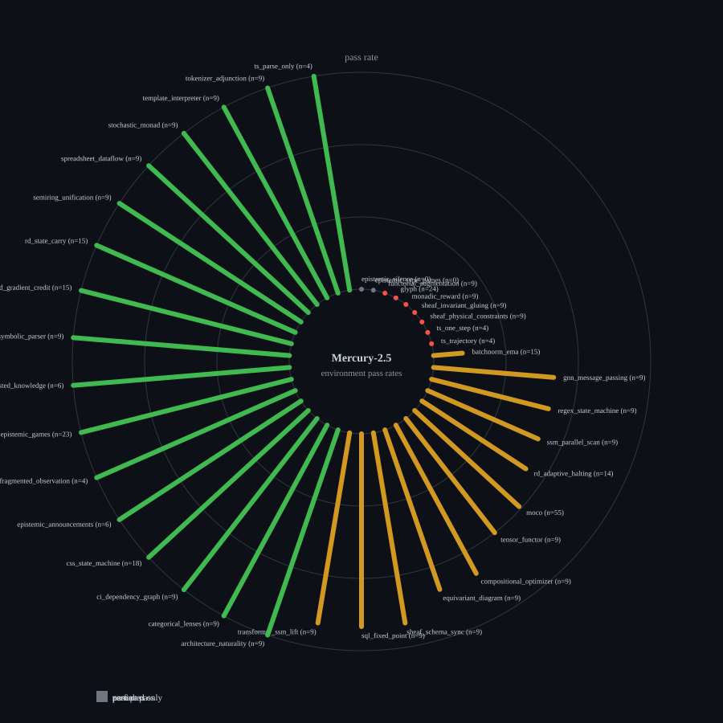

*by StrangeTcy*

<dl class="epistemic-status">
  <dt>Original ideas</dt>
  <dd>The bimodal capability map and the claim that environment identity dominates difficulty labels.</dd>
  <dt>Synthesis</dt>
  <dd>Role-separated analysis over the archived Mercury evidence.</dd>
  <dt>Prose</dt>
  <dd>Final writer from evidence dossier and editorial blueprint.</dd>
  <dt>Certainty</dt>
  <dd>Observed on one model/provider; mixed judge guarantees; no replication.</dd>
  <dt>Importance</dt>
  <dd>Shows that aggregate pass rates hide a sharp environment split.</dd>
</dl>

Mercury-2.5 does not have a single difficulty. Across 38 environments and 405 scored cases, its pass rate is 0.684 overall, but that average conceals a split: seven environments score 0.00, seventeen score 1.00, and two are entirely unscored (epistemic_silence, epistemic_type_games). The environment matters more than the difficulty label.

The seven zero-pass environments are glyph, functorial_augmentation, monadic_reward, sheaf_invariant_gluing, sheaf_physical_constraints, ts_one_step, and ts_trajectory. Two further environments (epistemic_silence, epistemic_type_games) have no scored cases at all. The perfect-pass environments include categorical_lenses, ci_dependency_graph, css_state_machine, epistemic_games, rd_gradient_credit, rd_state_carry, semiring_unification, spreadsheet_dataflow, stochastic_monad, template_interpreter, tokenizer_adjunction, ts_parse_only, neuro_symbolic_parser, epistemic_announcements, epistemic_fragmented_observation, and epistemic_nested_knowledge.

This is not a clean ranking of reasoning ability. The environments differ in task type, judge guarantee (189 behavioral-reference, 227 compile-only), and scoring. What the split does show is that Mercury's competence is sharply environment-dependent: some task families are reliably solvable, others reliably not, with little middle ground.

The failure modes reinforce this. Of 128 FAIL verdicts, 51 are underfit and 49 are overfit_visible_tests. Source-invalid (9), runtime (11), invalid-action (5), and training-failed (3) cases are the minority. The dominant failures are not crashes but partial solutions and visible-test gaming — a behavioural signature, not an infrastructure one.

The implication for evaluation: report per-environment and per-judge-guarantee, never a single score. A 0.684 average is accurate and misleading at the same time.

*Figure 1. Radial overview of all 38 environments by pass rate (green = perfect, red = zero, amber = partial, grey = unscored only). Spoke length encodes pass rate; labels include scored denominators. Not a calibrated capability scale.*

*Figure 2. Per-environment pass proportions with exact numerators and denominators.*

Caveats: single model and provider; mixed judge guarantees; one seed per cell; source repository dirty at run time.
