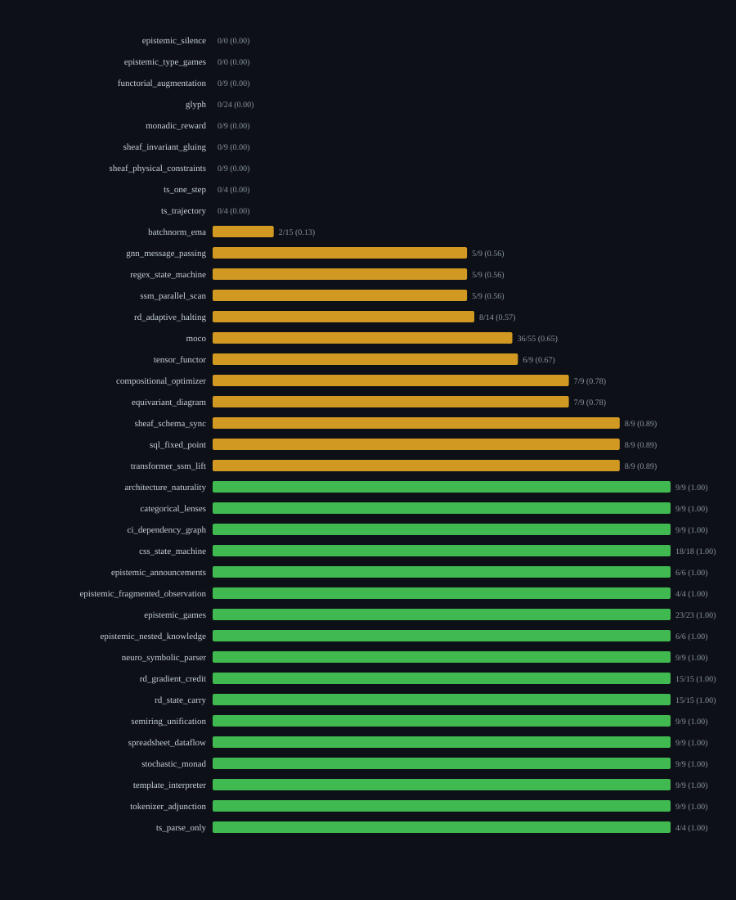

*by StrangeTcy*

<dl class="epistemic-status">
  <dt>Original ideas</dt><dd>The structural reading of the outcome distribution, and the reconciliation between environment-level aggregates and a finer environment × difficulty-tuple matrix. No new model runs.</dd>
  <dt>Synthesis</dt><dd>Counts from the archived Mercury-2.5 campaign: 416 selected cases in 38 environments, grouped by environment outcome and cross-checked against a 340-row tuple matrix.</dd>
  <dt>Prose</dt><dd>Written for this article; first-person, exploratory, and deliberately conservative.</dd>
  <dt>Certainty</dt><dd>High on the recorded counts and the arithmetic that follows from them. Low on anything that resembles a difficulty effect, a monotonic difficulty ladder, or a cross-environment ranking: single seed, mostly single-case rows, and incommensurable difficulty labels.</dd>
  <dt>Importance</dt><dd>A finer-grained table is easy to mistake for a stronger one. Here, the move from 38 environment aggregates to 340 tuple rows mostly adds rows with less information each.</dd>
</dl>

*Revision note: this replaces the version published on 2026-10-16. The first version worked from environment-level aggregates alone. This version keeps that structure as the headline and adds the 340-row tuple matrix as an exploratory second layer. Claims that did not survive the cross-check are corrected or withdrawn below, in the open.*

Mercury-2.5 passed 68.4% of the scored cases in this campaign. What would I expect if I opened one of its environments at random? The `ts_*` results make that question awkward: `ts_parse_only` is 4/4, while `ts_one_step` and `ts_trajectory` are each 0/4. All three contribute to the same pooled number. A single pooled pass rate smooths a jagged landscape of complete successes, complete failures, and unequal testing conditions into one figure.

I want to know what that number summarizes before I rely on it. These are judgments the campaign's judges assigned to selected cases. They are not repeated measurements of general capability, and an environment's name is not a difficulty rating.

## First, count the cases that received a judgment

The archive contains **416 selected cases in 38 environments**. Of those, 405 received a PASS or FAIL judgment: 277 PASS and 128 FAIL. So **277/405, or 68.4%**, is the scored-case pass rate. The other 11 cases were never scored. That is a judge-coverage gap, not a third outcome, and it is discussed below. The fraction **277/416, or 66.6%**, answers a different question: the share of all selected cases with an observed PASS. It is not a pass rate, because it counts 11 unknown outcomes as failures.

| Environment outcome | Environments | PASS / scored cases | Share of scored cases | Unscored cases |
|---|---:|---:|---:|---:|
| Every scored case passed | 17 | 172/172 | 42.5% | 0 |
| Some passed, some failed | 12 | 105/165 | 40.7% | 1 |
| No scored case passed | 7 | 0/68 | 16.8% | 0 |
| No scored cases | 2 | — | — | 10 |
| **Total** | **38** | **277/405** | **100%** | **11** |

Twenty-four of the 36 environments with scored cases sit at an endpoint: every case passed, or every case failed. This is an endpoint-heavy map. It is not evidence of bimodality. Some endpoints rest on 4 cases and others on 23 or 24, and this table cannot show how stable any endpoint would be under new cases or seeds. The 12 mixed environments are not minor exceptions: they hold 165 of the 405 scored cases (40.7%), ranging from 2/15 to 8/9.

## The endpoint-heavy distribution

The 17 environments where every scored case passed are:

- 9/9 in `architecture_naturality`, `categorical_lenses`, `ci_dependency_graph`, `neuro_symbolic_parser`, `semiring_unification`, `spreadsheet_dataflow`, `stochastic_monad`, `template_interpreter`, and `tokenizer_adjunction`;
- 18/18 in `css_state_machine`;
- 15/15 in `rd_gradient_credit` and `rd_state_carry`;
- 23/23 in `epistemic_games`;
- 6/6 in `epistemic_announcements` and `epistemic_nested_knowledge`, 4/4 in `epistemic_fragmented_observation` and `ts_parse_only`.

The seven environments with no scored pass are `functorial_augmentation`, `monadic_reward`, `sheaf_invariant_gluing`, and `sheaf_physical_constraints` (0/9 each), `ts_one_step` and `ts_trajectory` (0/4 each), and `glyph` (0/24). Two caveats apply to this group. First, eight of the nine `monadic_reward` cases carry a `rejected` disposition in the archive, which I discuss below. Second, a zero here means no PASS among the cases that were judged. It does not establish a shared failure mechanism.

The remaining mixed environments are `sheaf_schema_sync`, `sql_fixed_point`, `transformer_ssm_lift` (8/9 each), `compositional_optimizer` and `equivariant_diagram` (7/9 each), `tensor_functor` (6/9), `gnn_message_passing`, `regex_state_machine`, and `ssm_parallel_scan` (5/9 each), `moco` (36/55), `rd_adaptive_halting` (8/14 scored, one case unscored), and `batchnorm_ema` (2/15).

The 0.684 pooled figure sits above a landscape where an environment is more likely to land at an endpoint than near 68% internally.

## Names are handles, not forecasts

Prefix labels such as `ts_*` or `sheaf_*` invite a reading of shared difficulty. In this archive they are not a reliable shortcut. `ts_parse_only` cleared 4/4 while `ts_one_step` and `ts_trajectory` each scored 0/4. `sheaf_schema_sync` passed 8/9 while `sheaf_invariant_gluing` and `sheaf_physical_constraints` each passed 0/9. `categorical_lenses` passed 9/9, `functorial_augmentation` passed 0/9, and `tensor_functor` passed 6/9. A shared name does not imply a shared outcome.

`glyph`, `moco`, and `batchnorm_ema` make the same point from another angle. Together they supply 94 of the 405 scored cases and 56 of the 128 failures (`glyph` 0/24, `moco` 36/55, `batchnorm_ema` 2/15). The pooled rate is shaped by where cases were selected. That is not evidence that these three share a failure mechanism.

## The 340-row matrix: what it adds, and what it does not

Beneath the 38 environments is a finer table: **340 rows, one per environment × difficulty-tuple combination, spanning 34 difficulty dimension names.** Each environment contributes between 4 and 15 rows. Three properties of this table have to be stated before any of its contents are used.

**Most rows are single cases.** 296 of the 340 rows report exactly one case. The other 44 rows report between two and six cases each. Across the 329 rows that carry a pass rate, **320 (97.3%) take the value 0 or 1 exactly**. A pass rate computed from a single case is a binary outcome, not a rate, so I treat those rows as outcomes and do not plot them on a continuous axis. 

**The 34 difficulty dimensions are not one scale.** They are environment-specific labels, not points on a shared ladder. Tuples cannot be pooled across environments, ranked against each other, or entered into a regression across the matrix. What the matrix supports is a set of within-environment descriptions, each read on its own axes.

**Most of the matrix repeats what the environment aggregate already says.** 214 of the 340 rows (63%) sit in environments where every row has the same outcome. In those environments the tuple rows carry no information beyond the aggregate. This is expected. Perfect-pass and zero-pass environments are homogeneous at the case level by construction. The new information is concentrated in the mixed environments, and most of it comes from the four environments where rows contain more than one case.

Across the matrix, 98 individual tuples have zero passes. They fall in 19 environments, which is more than the seven environments with zero scored passes. I return to this in the 10-versus-7 section below.

### What "one seed per cell" means here

The evidence does not define "cell". The row-level counts show that a cell must be an environment × difficulty-tuple row, not a single case. The 44 multi-case rows fall in exactly four environments: `moco` (15 rows, 55 cases), `glyph` (12 rows, 24 cases), `css_state_machine` (9 rows, 18 cases), and `epistemic_games` (8 rows, 23 cases). These totals equal each environment's full case count. Summing the 296 single-case rows and the 120 cases inside multi-case rows gives 416, the selected-case total.

This reading is an inference from the arithmetic. The archive does not state the convention. All 416 cases carry seed 0, and no case was re-run under a second seed. So a row with several cases holds several distinct selected cases sharing one difficulty tuple. No variance or stability estimate exists at either the environment level or the tuple level.

## Only `moco` shows fractional outcomes

Of the four multi-case environments, three are already endpoints: `css_state_machine` (18/18), `glyph` (0/24), and `epistemic_games` (23/23). A uniformly passing or uniformly failing environment cannot contain a row with a different outcome, so `moco` is the only environment where multi-case rows can take values other than 0 or 1.

`moco` has 15 rows and 55 cases, with 36 PASS (65.5%). Nine of its rows are fractional. The other six sit at 0.0 or 1.0; for example, 3/3 and 2/0. The fractional values are 1/6, 1/3, 2/5, 2/3, 3/4, and 5/6. The archive gives me the set of achievable values and the row totals. It does not give a row-by-row key that links each fraction to a specific tuple. I can describe moco's range of outcomes. I cannot draw its shape, and I am not going to simulate one.

## Two difficulty claims that do not hold up

The original analysis reported non-monotonic difficulty transitions in three environments: `moco`, `css_state_machine`, and a SQL environment. Two of these need correction.

**The CSS claim is withdrawn.** `css_state_machine` scored 18/18. Its nine tuple rows must each read 2/2, because any row below 1.0 would have produced a FAIL and broken the environment's perfect record. A constant sequence satisfies both monotone definitions, so it cannot be non-monotonic. The earlier claim cannot be reconciled with the environment total, and I have dropped it rather than patch it.

**The MoCo and SQL observations remain open.** These environments are not at an endpoint, so internal variation is possible. But under a single-seed, mostly binary design, a non-monotonic pattern across a small grid of tuples may be what chance alone produces. I have not computed how often that happens for these grids, so the base rate is an open check. Until it is done, a non-monotonic pattern here is weak evidence about difficulty specifically. I report these as open observations, not effects, and I attach no difficulty-effect language to them.

## The judge-coverage gap: 11 unscored cases

Eleven cases were never scored. Six are in `epistemic_silence` and four are in `epistemic_type_games`. Those two environments therefore have no scored outcome at any tuple, not merely a small sample. The eleventh is one case in `rd_adaptive_halting`, at the tuple where all five dimensions are `easy`. That tuple is identified in the matrix, and it accounts for the "one unscored" noted against that environment's 8/14 figure.

The judge-coverage gap is a fact about the judging pipeline for those cases. It is not a model result. Treating those cases as failures would inflate the denominator, so I do not. The scored pass rate remains 277/405.

## The 10-versus-7 discrepancy

The project's overview document states 10 zero-pass environments. The case-level counts support **7**: `functorial_augmentation`, `monadic_reward`, `sheaf_invariant_gluing`, `sheaf_physical_constraints`, `ts_one_step`, `ts_trajectory`, and `glyph`. Adding the two fully unscored environments gives 9, not 10. Those two are a coverage gap, not zero-pass results, so adding them would conflate two different things.

I tested one explanation: that the overview counted environments containing at least one zero-pass tuple. That gives 19, not 10, so it does not reproduce the figure. The source of the 10 is therefore unexplained. I use 7 throughout, because it is the figure the scored-case totals support. The overview's count should be corrected or its method published before it is cited again.

## Failure labels: global counts only

The 128 FAIL outcomes carry six labels: `underfit` (51), `overfit_visible_tests` (49), `runtime_error` (11), `source_invalid` (9), `invalid_action` (5), and `training_failed` (3). The original article split `runtime_error` into `RUNTIME_ERROR` (9) and `runtime_error` (2). That split was a capitalization artifact. The archive consolidates them into 11.

`underfit` and `overfit_visible_tests` together account for 100 of the 128 failures. These are recorded classifications, not observations of the model's internal reasoning, and I cannot infer a mechanism from their names. The archive gives only global counts, with no environment-level breakdown. So I cannot cross-tabulate failure labels by environment, and I do not attempt to.

## Judge guarantees: global counts only

The campaign records **189 `behavioral_reference` and 227 `compile_only` judge guarantees** across the 416 selected cases. A behaviorally referenced PASS and a compile-only PASS are not the same claim. Calling every perfect-pass environment "behaviorally solved" would go beyond this evidence. The archive again gives only global totals, so I cannot test whether perfect-pass environments lean toward one judge type.

## The selection frame and its disclosures

Several selection facts sit outside the 416 selected cases and affect how far the numbers travel.

- **Omitted before scoring.** The exclusion record lists 80 cases that never entered the selected set: 56 intervention-twin omissions, 14 known-gate calibration failures, and 10 cases whose input modality the provider does not accept (all in `rope`). The provenance summary gives 24 known-gate omissions rather than 14. I have not resolved that difference, and the figure in the exclusion record is the one I use.
- **Rejected dispositions.** Ten scored FAIL cases carry a `rejected` disposition: eight `monadic_reward` cases (of its nine scored cases), one `batchnorm_ema` case, and one `transformer_ssm_lift` case. The archive does not define "rejected". I keep all ten in the counts. Because eight of `monadic_reward`'s nine scored cases carry the label, its zero-pass result rests mostly on cases the archive marks as rejected.
- **One provider-outage PASS.** One PASS, in `ts_parse_only__witness_status=broken_representation=flat__seed-0`, is marked performance-ineligible. Its exclusion note describes a provider-attributed terminal failure, but its verdict is PASS. I keep it in the 277 count and flag the inconsistency here rather than resolve it.

## Confounds

- **Single seed.** Each selected case was run once with seed 0. There is no variance estimate at either the environment or tuple level. A 5/9 in `regex_state_machine`, or any single-case tuple outcome, could move substantially under a different seed. Finer row counts carry the same uncertainty, presented with more apparent precision.
- **Source state.** The campaign's source repository was recorded as dirty. The exact working-tree state [m-word] for reproduction, so the effect of the uncommitted changes on any environment or tuple cannot be isolated.
- **Selection.** The 416 cases were selected, and 80 more were omitted before scoring. Environment totals reflect that selection, not a random sample of tasks.

## What this supports

On this archived selection, Mercury-2.5 received **277 PASS judgments among 405 scored cases**. There were all-pass outcomes in 17 environments, all-fail in 7, mixed outcomes in 12, and no scored outcome in 2. The 340-row matrix mostly confirms that picture. 63% of its rows repeat their environment's outcome, 97.3% of its scored rows are binary, and its 34 dimension names cannot be pooled or ranked.

The finer grain earns its keep in one place: `moco`, where multi-case rows produce non-endpoint outcomes. Even there, the archive supports describing the range of outcomes, not drawing their shape.

Two difficulty claims did not survive the arithmetic. The CSS claim is withdrawn. The MoCo and SQL observations remain open and carry no difficulty-effect language. The 10-versus-7 discrepancy is still open: 7 is the figure the scored totals support, and the origin of 10 is unexplained.

I would keep **68.4%** as the answer to one precise question: what fraction of scored, selected cases received PASS? I would not let it stand alone, and I would not let a finer-grained table stand in for it. The more revealing picture is still the environment-level map: the zeros, the perfect scores, and the 40.7% of scored cases that fall between them. The tuple matrix belongs beside that map as a narrow, mostly confirmatory second layer. It is useful where a row holds more than one case, and close to silent everywhere else.

## What this does not show

It does not show why any environment passed or failed. It does not show that a "difficulty" axis is monotone, that any environment's pass rate would hold under new seeds, or that the pooled 68.4% describes the model's typical behavior on tasks outside this selection. It does not rank environments or difficulty labels against each other. It is a description of one archived run, read conservatively.
