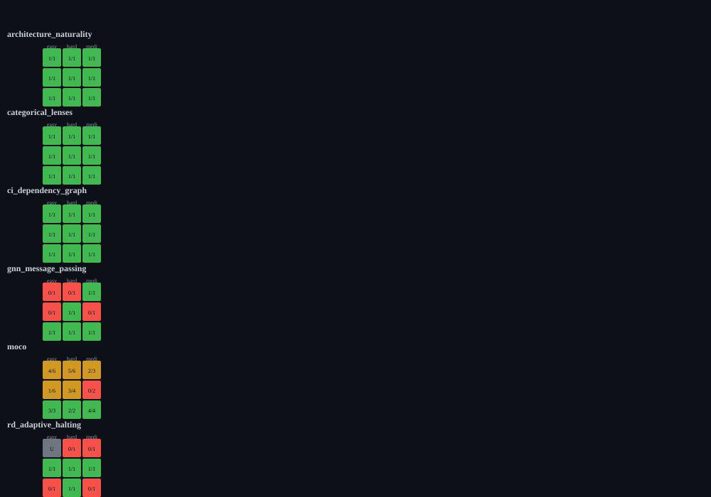

*by StrangeTcy*

<dl class="epistemic-status">
  <dt>Original ideas</dt>
  <dd>Non-monotonic difficulty transitions as the central object of study.</dd>
  <dt>Synthesis</dt>
  <dd>Role-separated analysis over the archived Mercury evidence.</dd>
  <dt>Prose</dt>
  <dd>Final writer from evidence dossier.</dd>
  <dt>Certainty</dt>
  <dd>Observed on one model; single seed per cell; no replication.</dd>
  <dt>Importance</dt>
  <dd>Challenges the assumption that harder labels mean harder outcomes.</dd>
</dl>

Difficulty labels are not a staircase. In several Mercury environments, the outcome across difficulty levels is non-monotonic: the middle level is harder than both ends, or the hardest label passes while an easier one fails.

In MoCo, visible-test levels yield pass, fail, pass. In CSS state machines, easy-surface cases over 3, 4, and 5 bits yield a partial score, a source-validation failure, and a pass. In SQL fixed points, easy-surface cases pass at graph-chain lengths 6 and 25 but fail source validation at length 12. These are not smooth degradations; they are qualitatively different failure layers at adjacent levels.

The reason is that "difficulty" changes different things in different environments. In regex state machines, hidden depth means input-string length (32, 128, 512 characters) and the model passes all three at the easy surface label. In MoCo, visible-test level changes test coverage. In CSS and SQL, surface labels change class names and graph sizes. The labels are not commensurable across environments, and sometimes not within one.

This matters for two reasons. First, a non-monotonic result is a signal that the manipulation is not isolating a single latent difficulty — it is changing the task. Second, single-seed cells cannot distinguish a real transition from noise. The campaign records one seed-0 run per selected cell, so every transition claim is provisional.

The strongest defensible statement: in this archived run, several environments show non-monotonic outcomes across their difficulty axes, and the axes themselves change different task properties. Whether those are real thresholds or seed-specific accidents requires replication.

*Figure 3. MoCo visible-test sweeps holding other dimensions fixed; each line is one control combination. Points show pass/fail at easy/medium/hard visible-test levels.*

*Figure 4. Environment × difficulty-tuple heatmap for six representative environments. Cells show pass counts over scored counts; grey = unscored.*

Caveats: single seed per cell; dirty source repository; mixed judge guarantees.
